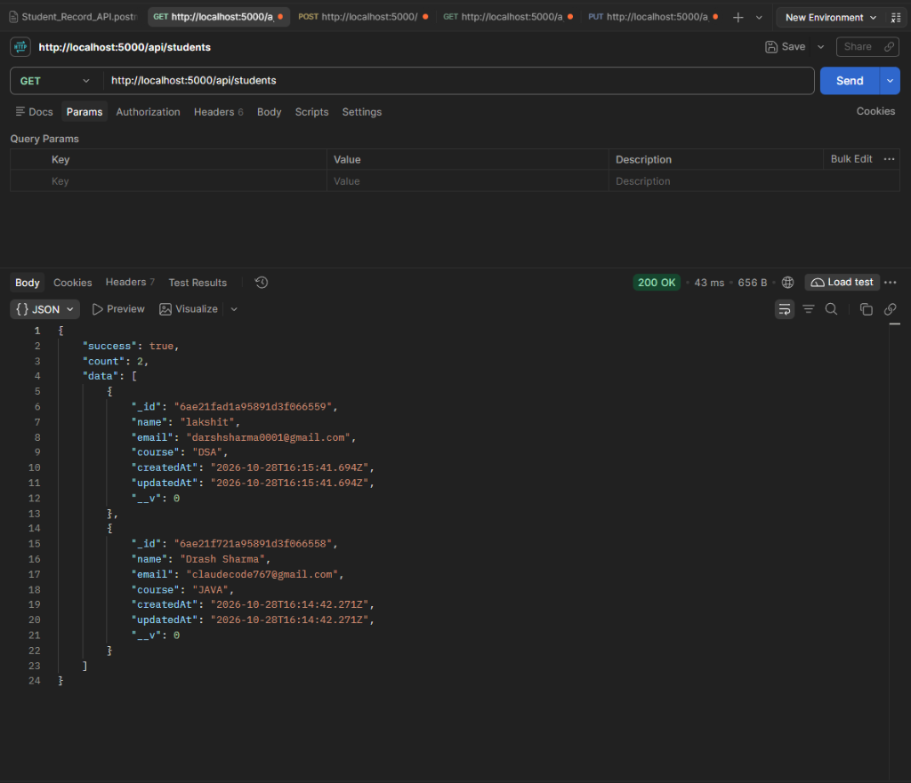
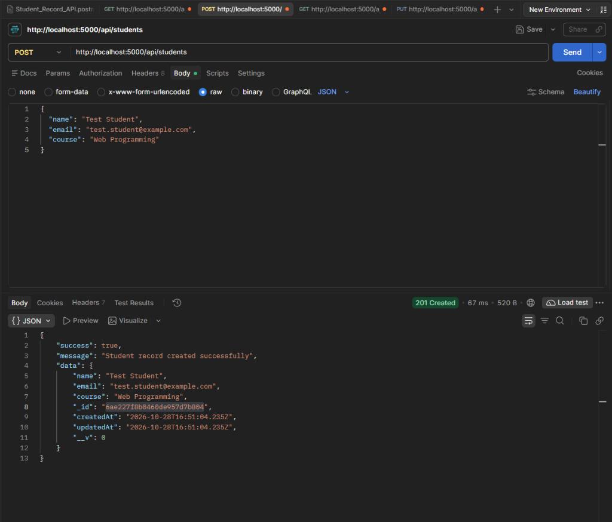
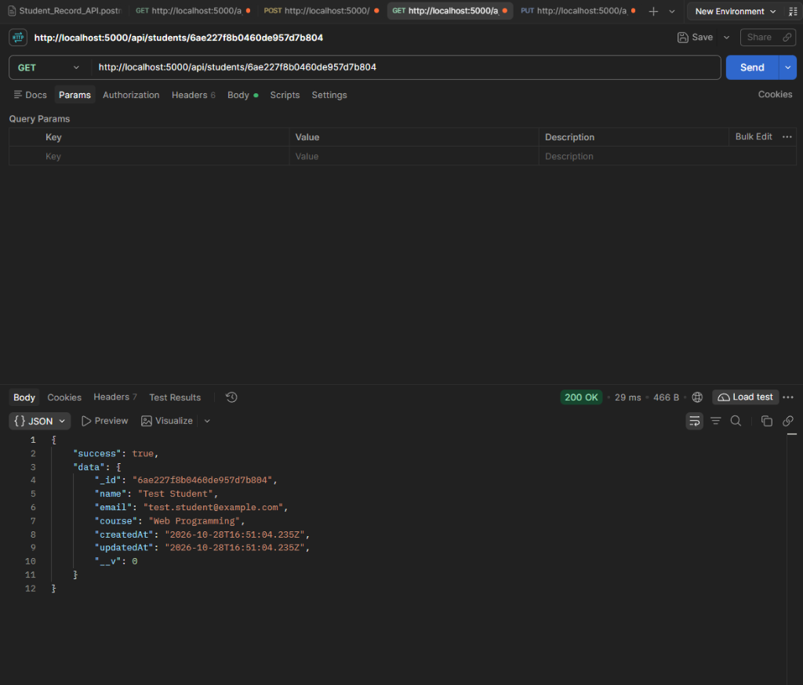
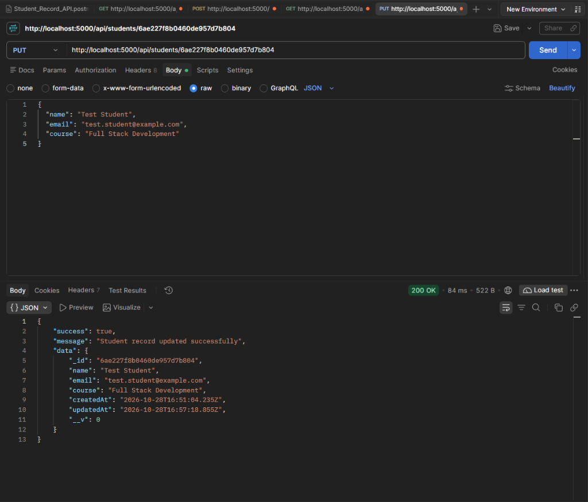
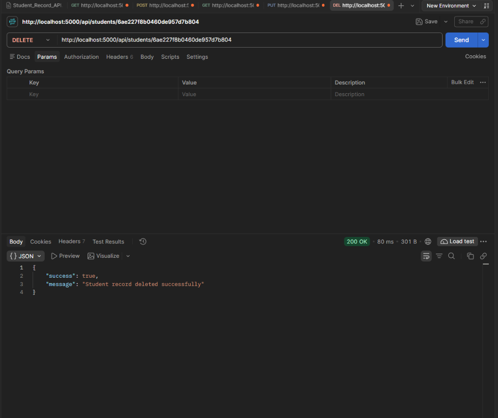

# Student Record Management System

A beginner-friendly web application for managing student records, built for a university Web Programming syllabus. The project demonstrates full CRUD functionality using a server-rendered Handlebars interface, a RESTful JSON API, and MongoDB persistence following an MVC-style pattern.

`Node.js · Express.js · Handlebars · MongoDB · Mongoose`

---

## Overview

This project provides a straightforward implementation of a Student Record Management System:
- **Web Interface:** Server-side rendered pages using Handlebars and styled with custom CSS for creating, viewing, updating, and deleting student records.
- **REST API:** Five JSON endpoints enabling programmatic CRUD operations and API testing via Postman.
- **Data Persistence:** MongoDB Atlas cloud database integrated through Mongoose schemas and models.

---

## Features

- **Create:** Add student records with Name, Email, and Course fields.
- **Read:** View all registered students in a responsive HTML table.
- **Update:** Edit existing records with client-side DOM population and server-side update.
- **Delete:** Remove student records with browser confirmation before deletion.
- **Validation:** Client-side format checks and Mongoose schema validation.
- **API Testing:** Documented REST endpoints tested and verified with Postman.

---

## Tech Stack

| Technology | Role |
| :--- | :--- |
| **Node.js** | Server-side JavaScript runtime environment |
| **Express.js** | Backend web application and routing framework |
| **Handlebars** | Server-side templating engine (`express-handlebars`) |
| **MongoDB Atlas** | Cloud NoSQL document database |
| **Mongoose** | Object Data Modeling (ODM) library for MongoDB |
| **HTML5 / CSS3 / JavaScript** | Responsive layout, styles, DOM manipulation, and validation |
| **Postman** | REST API testing and collection runner |

---

## Project Structure

```text
student-record-management/
├── config/
│   └── db.js                    # MongoDB Atlas connection setup
├── controllers/
│   └── studentController.js     # Web page and API controller logic
├── models/
│   └── Student.js               # Mongoose schema and model
├── public/
│   ├── css/style.css            # Custom CSS styling
│   └── js/script.js             # Client-side DOM events and validation
├── routes/
│   ├── studentRoutes.js         # Browser view routes
│   └── studentApiRoutes.js      # REST API JSON endpoints
├── screenshots/                 # Recorded Postman test runs
├── views/
│   ├── layouts/main.handlebars  # Base HTML layout
│   └── students/index.handlebars# Main view with form and table
├── .env.example                 # Environment variables template
├── .gitignore                   # Excludes .env, node_modules, and caches
├── app.js                       # Express application configuration
├── package.json                 # Dependencies and npm scripts
├── README.md                    # Project documentation
├── server.js                    # Application entry point
└── Student_Record_API.postman_collection.json # Postman collection
```

---

## Prerequisites & Setup

### Prerequisites
- [Node.js](https://nodejs.org/) (v18.x or newer) and npm
- [Git](https://git-scm.com/)
- A free [MongoDB Atlas](https://www.mongodb.com/atlas/database) account (or local MongoDB instance)

### Installation

1. **Clone the repository:**
   ```bash
   git clone https://github.com/<YOUR_GITHUB_USERNAME>/student-record-management.git
   cd student-record-management
   ```

2. **Install dependencies:**
   ```bash
   npm install
   ```

3. **Configure environment variables:**
   Copy `.env.example` to `.env`:
   - On macOS/Linux: `cp .env.example .env`
   - On Windows (PowerShell): `Copy-Item .env.example .env`
   - On Windows (CMD): `copy .env.example .env`

4. **Configure MongoDB Atlas:**
   Follow the [MongoDB Atlas Getting Started Guide](https://www.mongodb.com/docs/atlas/getting-started/) to create an M0 cluster. In the Atlas dashboard:
   - Create a database user with a secure password.
   - Under **Network Access**, add your current IP address.
   - Obtain your application connection string and add it to `.env`.

5. **Start the application:**
   ```bash
   # Development mode (with auto-restart via nodemon)
   npm run dev

   # Standard production mode
   npm start
   ```

6. **Access the application:**
   Open [http://localhost:5000](http://localhost:5000) in your web browser.

---

## Environment Configuration

Define the following variables in your local `.env` file:

```env
PORT=5000
MONGO_URI=mongodb+srv://<username>:<password>@<cluster-url>/studentDB?retryWrites=true&w=majority
```

> **Security Note:** Never commit your `.env` file to version control. The `.env` file is included in `.gitignore` to protect your credentials. In MongoDB Atlas, always use a strong database user password and restrict network access to your current IP address rather than allowing unrestricted access.

---

## API Reference

Base URL: `http://localhost:5000`

| Method | Endpoint | Purpose |
| :--- | :--- | :--- |
| `GET` | `/api/students` | Retrieve all student records |
| `POST` | `/api/students` | Create a new student record |
| `GET` | `/api/students/:id` | Retrieve a specific student by ID |
| `PUT` | `/api/students/:id` | Update an existing student record |
| `DELETE` | `/api/students/:id` | Delete a student record |

### Example Request Body (`POST` / `PUT`)

```json
{
  "name": "Jane Doe",
  "email": "jane.doe@example.com",
  "course": "Computer Science"
}
```

---

## Postman API Testing

The project includes `Student_Record_API.postman_collection.json` in the root directory for automated API testing.

### Import Instructions
1. Open **Postman Desktop**.
2. Click **Import** in the top navigation bar.
3. Select `Student_Record_API.postman_collection.json`.
4. Run requests against `http://localhost:5000`.

### Recorded Test Results

<details open>
<summary><b>Click to expand / collapse Postman execution screenshots</b></summary>
<br>

#### 1. GET — Retrieve all students (`200 OK`)


#### 2. POST — Create student (`201 Created`)


#### 3. GET by ID — Retrieve one student (`200 OK`)


#### 4. PUT — Update student (`200 OK`)


#### 5. DELETE — Remove student (`200 OK`)


</details>
