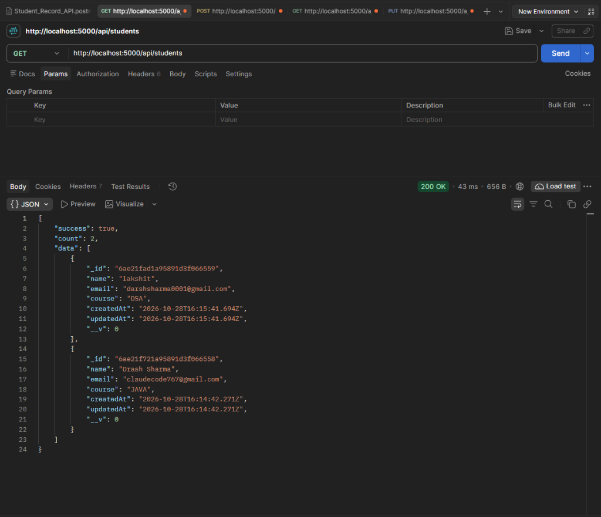
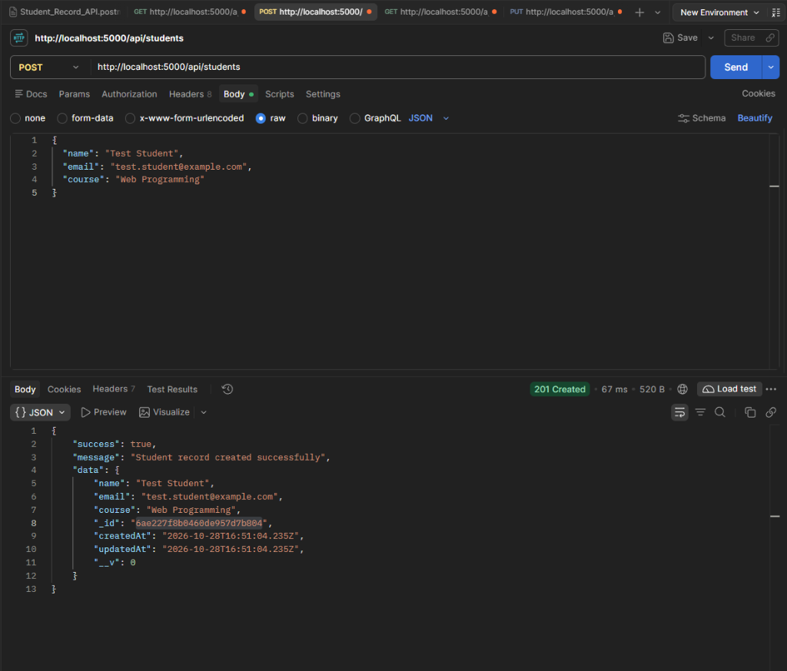
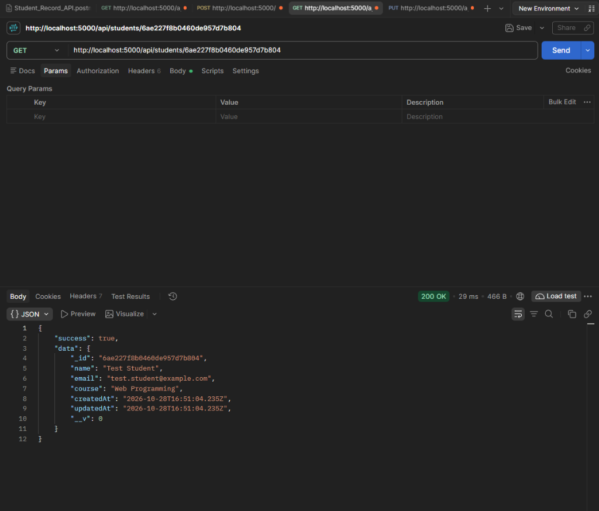
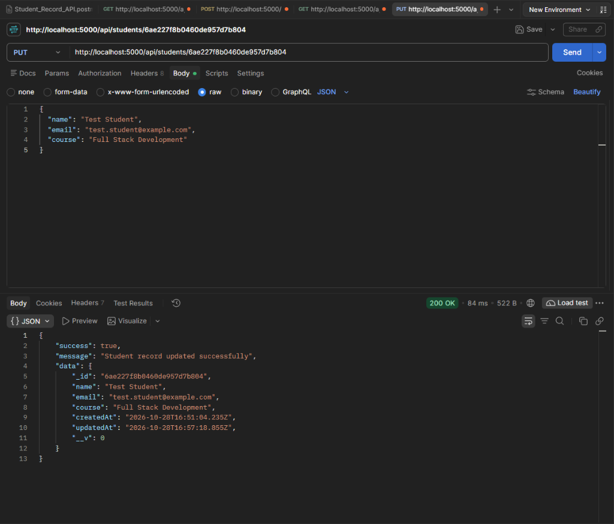
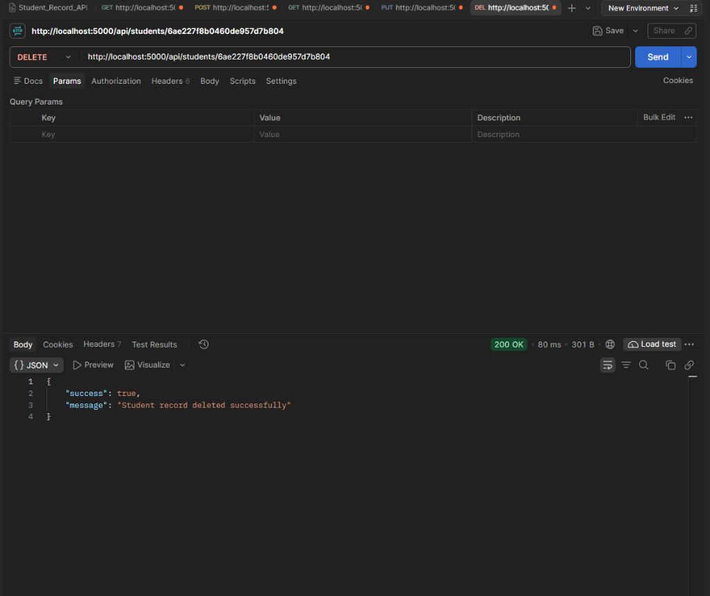

# 🎓 Student Record Management System — REST API

A lightweight, robust, and beginner-friendly **Backend RESTful API** for managing student records, built for a university Web Programming course. This project focuses exclusively on backend architecture, database modeling, CRUD API design, error handling, and automated API testing.

**Tech Stack:** `Node.js` · `Express.js` · `MongoDB Atlas` · `Mongoose` · `Postman`

---

## 📌 Features

- ⚡ **Full CRUD Operations:** Comprehensive endpoints to create, retrieve, update, and delete student documents.
- 🍃 **Cloud Persistence:** Seamless connection to MongoDB Atlas with Mongoose ODM schemas and models.
- 🛡️ **Data Validation:** Enforces required fields, minimum character lengths, valid email regex patterns, and unique email constraints.
- 🔒 **Secure Architecture:** Centralized error-handling middleware preventing internal stack trace leaks; environment variables kept strictly private.
- 🚦 **Standard HTTP Status Codes:** Returns appropriate semantic status codes (`200 OK`, `201 Created`, `400 Bad Request`, `404 Not Found`, `500 Server Error`).
- 📮 **Automated API Testing:** Verified with Postman covering both happy paths and negative validation test cases.

---

## 🛠️ Tech Stack

| Technology | Role & Purpose |
| :--- | :--- |
| **🟢 Node.js** | Server-side JavaScript runtime environment |
| **⚡ Express.js** | Backend web framework and API route handler |
| **🍃 MongoDB Atlas** | Cloud NoSQL document database |
| **📦 Mongoose** | Object Data Modeling (ODM) library and schema validator |
| **📮 Postman** | REST API testing, collection runner, and verification |

---

## 📁 Project Structure

```text
student-record-management/
├── 📁 config/
│   └── db.js                              # MongoDB connection lifecycle & error handling
├── 📁 controllers/
│   └── studentController.js               # Clean REST API CRUD controller logic
├── 📁 middleware/
│   └── errorMiddleware.js                 # Centralized 404 & global error handling
├── 📁 models/
│   └── Student.js                         # Mongoose schema and model definition
├── 📁 routes/
│   └── studentRoutes.js                   # Express REST API routes (/api/students)
├── 📁 screenshots/                        # Verified Postman test execution screenshots
│   ├── 1-get-all-students.png
│   ├── 2-post-create-student.png
│   ├── 3-get-student-by-id.png
│   ├── 4-put-update-student.png
│   └── 5-delete-student.png
├── 📄 .env.example                        # Safe environment variables template
├── 📄 .gitignore                          # Excludes .env, node_modules, and cache
├── 📄 app.js                              # Express app configuration & middleware
├── 📄 package.json                        # Dependencies and npm scripts
├── 📄 README.md                           # Documentation with static screenshots
├── 📄 server.js                           # Server entry point & DB connection guard
└── 📄 Student_Record_API.postman_collection.json # 8-request Postman test collection
```

---

## ⚙️ Prerequisites & Setup

### Prerequisites
- [Node.js](https://nodejs.org/) (v18.x or newer) and npm
- [Git](https://git-scm.com/)
- A free [MongoDB Atlas](https://www.mongodb.com/atlas) deployment (or local MongoDB)
- [Postman Desktop](https://www.postman.com/downloads/) for API testing

### 1. Clone & Install Dependencies

```bash
git clone https://github.com/darshsharma-bit/student-record-management.git
cd student-record-management
npm install
```

### 2. Configure Environment Variables

Create your local `.env` file from the provided template:

**PowerShell (Windows):**
```powershell
Copy-Item .env.example .env
```

**Bash (macOS / Linux):**
```bash
cp .env.example .env
```

Configure your MongoDB Atlas connection string in `.env`:

```env
PORT=5000
MONGO_URI=mongodb+srv://<username>:<password>@<cluster-host>/studentDB?retryWrites=true&w=majority
```

> 🔒 **Security Notice:** Never commit `.env` to Git. Your database password and cluster URL must remain private. Ensure your current public IP is added under **Security > Network Access** in MongoDB Atlas.

### 3. Start the Server

```bash
# Development mode (auto-reload on code changes)
npm run dev

# Production mode
npm start
```

Base URL: `http://localhost:5000`

---

## 🚀 REST API Reference

Base URL: `http://localhost:5000`

| Method | Endpoint | Description | Success Status |
| :---: | :--- | :--- | :---: |
| `GET` | `/` | API status and route discovery | `200 OK` |
| `GET` | `/api/students` | Retrieve all student records | `200 OK` |
| `POST` | `/api/students` | Create a new student record | `201 Created` |
| `GET` | `/api/students/:id` | Retrieve a single student by MongoDB ID | `200 OK` |
| `PUT` | `/api/students/:id` | Update an existing student's details | `200 OK` |
| `DELETE` | `/api/students/:id` | Delete a student record from the database | `200 OK` |

### 📝 Sample Request Body (`POST` / `PUT`)

```json
{
  "name": "Jane Doe",
  "email": "jane.doe@example.com",
  "course": "Computer Science"
}
```

### 📤 Sample Response (`201 Created`)

```json
{
  "success": true,
  "message": "Student record created successfully",
  "data": {
    "_id": "6ae891a2f35b68e72ec74900",
    "name": "Jane Doe",
    "email": "jane.doe@example.com",
    "course": "Computer Science",
    "createdAt": "2026-11-02T13:35:28.120Z",
    "updatedAt": "2026-11-02T13:35:28.120Z"
  }
}
```

---

## 📮 Postman API Testing & Verification

The project includes `Student_Record_API.postman_collection.json` in the root folder, covering 8 test cases:

1. `GET /api/students` — Retrieve all students (`200 OK`)
2. `POST /api/students` — Create student (`201 Created`)
3. `GET /api/students/:id` — Retrieve student by ID (`200 OK`)
4. `PUT /api/students/:id` — Update student (`200 OK`)
5. `DELETE /api/students/:id` — Delete student (`200 OK`)
6. `GET /api/students/invalid-id` — Malformed ID validation (`400 Bad Request`)
7. `GET /api/students/<nonexistent-id>` — Non-existent student (`404 Not Found`)
8. `POST /api/students` — Missing required fields validation (`400 Bad Request`)

### How to Import
1. Open **Postman Desktop**.
2. Click **Import** in the top-left navigation bar.
3. Select `Student_Record_API.postman_collection.json`.
4. Run requests against `http://localhost:5000`.

---

## 📸 Test Execution Evidence

All test results below are statically displayed and verified directly against the running API:

### 1. 🟢 GET — Retrieve All Students (`200 OK`)


---

### 2. 🔵 POST — Create Student (`201 Created`)


---

### 3. 🟡 GET by ID — Retrieve Student by ID (`200 OK`)


---

### 4. 🟠 PUT — Update Student (`200 OK`)


---

### 5. 🔴 DELETE — Remove Student (`200 OK`)


---

## 🔍 Troubleshooting

- **MongoDB Connection Error (`SSL alert number 80` / `ERR_SSL_TLSV1_ALERT_INTERNAL_ERROR`):**  
  MongoDB Atlas drops connections from unwhitelisted IP addresses. In the Atlas dashboard, go to **Security > Network Access** and click **Add Current IP Address**.
- **Port Conflict (`EADDRINUSE :::5000`):**  
  Another background process is using port 5000. Stop that process or set `PORT=5001` in your `.env` file.
- **Malformed ID (`400 Bad Request` vs `404 Not Found`):**  
  MongoDB requires 24-character hexadecimal IDs. Invalid string formats return `400 Bad Request`. Valid 24-character IDs not present in the database return `404 Not Found`.
